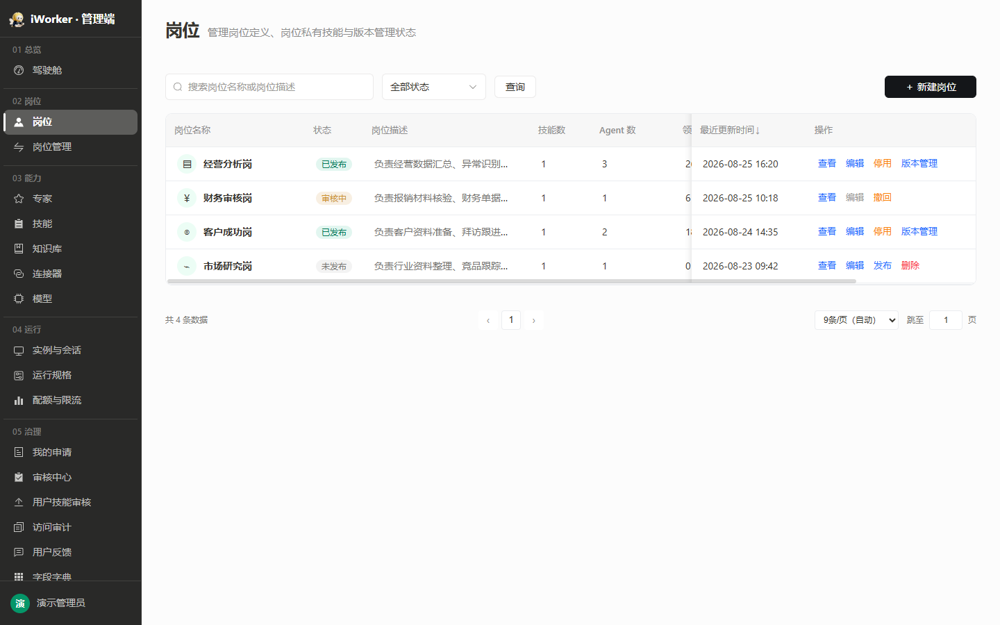

# 岗位产品需求

## 一、导航栏

### 1. 功能说明

导航栏用于帮助管理员搜索岗位、筛选状态，并进入新建岗位流程。岗位用于定义一类工作角色并关联岗位私有技能，发布后供岗位管理使用。

- **页面入口**：侧边栏"02 岗位 / 岗位"。
- **页面标题**：展示"岗位"。
- **页面说明**：文案"管理岗位定义、岗位私有技能与版本管理状态"。
- **搜索框**：占位提示为"搜索岗位名称或岗位描述"，支持按岗位名称或描述模糊搜索。
- **状态筛选**：默认"全部状态"，可选择"未发布、审核中、已发布"。
- **查询按钮**：按照当前搜索内容和状态刷新列表。
- **新建入口**：右侧展示【＋ 新建岗位】，点击后打开居中弹窗（岗位名称最多 64 个字符 + 岗位描述最多 2000 个字符，与人格页签口径一致），创建后提示"岗位已创建，请完善岗位配置"并进入岗位详情页。
- 无匹配结果时展示"没有符合条件的岗位"。

### 2. 交互规则

- 搜索和状态筛选可组合使用；搜索内容在点击【查询】或按回车后生效。
- 清空搜索内容后点击【查询】或按回车，按剩余条件刷新。
- 切换状态筛选后列表立即刷新。
- 点击【＋ 新建岗位】保留列表当前筛选条件。

### 3. 页面状态与异常场景

- **加载中**：列表区域展示加载状态。
- **暂无数据 / 无查询结果**：展示"没有符合条件的岗位"，保留当前条件。
- **加载失败**：展示"加载失败"和【重试】；点击【重试】后重新加载列表。失败状态优先于空状态展示。
- **无页面权限**：不展示岗位入口，也不允许进入岗位页面。

## 二、岗位列表

### 1. 列表展示

岗位列表集中展示平台已定义的岗位。

- **岗位名称**：展示图标和岗位名称。
- **状态**：作为独立列紧跟名称列之后展示，标签为【未发布】【审核中】【已发布】。
- **岗位描述**：单行缩略，悬停查看完整内容；无描述显示"—"。
- **技能数**：展示当前关联的岗位私有技能总数；悬停提示"当前岗位关联的岗位私有技能总数"。
- **领用数**：展示当前已领用该岗位的用户总数；悬停提示"当前已领用该岗位的用户总数"。
- **最新版本**：展示最近一次审核通过并正式发布的版本号；尚无版本时显示"—"。不展示待审核版本号。
- **最近更新时间**：展示最近一次保存的时间，精确到分钟；支持点击列头排序。
- **操作**：按状态展示【查看】【编辑】【发布】【撤回】【停用】【删除】【版本管理】。

列表支持分页，平台各列表页采用同一套分页策略：每页条数按页面可用高度自动计算作为初值（最少 5 条、最多 30 条），用户可从 10 / 20 / 30 / 50 手动切换，自动值不在档位内时在下拉中单列并标注"（自动）"；分页条位于列表卡片之外整行展示，左侧"共 N 条数据"、中间页码、右侧每页条数与"跳至 __ 页"（输入框常显当前页，越界自动修正到合法范围）。

### 2. 排序规则

- 默认按最近更新时间由近到远排列，点击列头切换升降序。
- 保存岗位配置或提交审核操作后，按新的最近更新时间重新排列。

### 3. 操作

#### 3.1 操作按钮展示规则

- 【查看】和【编辑】为固定操作，所有状态展示；审核中【编辑】置灰并提示"审核中不可编辑"。
- 各状态按钮组合：
  - **未发布**：【查看】【编辑】【发布】【删除】，共 4 个按钮；【删除】按钮悬停提示"删除前需二次确认"。
  - **审核中**：【查看】【编辑】（置灰）【撤回】，共 3 个按钮。
  - **已发布**：【查看】【编辑】【停用】【版本管理】，共 4 个按钮。

#### 3.2 查看 / 编辑

- 点击【查看】进入岗位详情页只读状态；点击【编辑】进入可编辑状态。
- 审核中的岗位只能查看，不可编辑。

#### 3.3 发布（首发）

- 【发布】用于"未发布"的岗位。满足全部发布前置条件后，点击后打开发布前检查弹窗。
- 岗位名称、岗位图标、岗位描述、领用页文案（至少 1 条）、示例问题（3 条）、岗位 SOP、采集字段（至少 1 个）、技能（至少引用 1 个技能）、自动化任务（至少 1 条）任一未完成时不执行发布，【发布岗位】点击后自动定位到缺失项所在页签并展示具体缺失项。
- 在发布弹窗确认提交后进入审核：岗位状态变为"审核中"，提示"已提交发布审核"。
- 审核通过后状态变为"已发布"，自动生成版本号并上线；审核被拒绝后回到"未发布"。

#### 3.4 撤回

- 【撤回】仅在"审核中"展示。
- 点击后弹出确认窗口，说明撤回后恢复提交审核前的状态。
- 待审发布撤回后回到"未发布"；待审停用撤回后回到"已发布"。
- 撤回成功提示"已撤回"。

#### 3.5 停用

- 【停用】在"已发布"且无审核中操作时展示。
- 有被用户领用时不可停用，弹窗提示"该岗位已被 N 个用户领用，需先解除领用后再停用"。
- 无领用时点击后弹出确认窗口，文案"停用「岗位名」需提交停用审核。审核通过前客户端仍可正常使用。"，确认按钮【提交停用审核】。
- 确认后提交停用审核，状态变为"审核中"；审核通过后岗位变为"未发布"，客户端停止提供；被拒绝或撤回后恢复"已发布"。
- 停用审核通过后已有领用关系保留不解除，该岗位仍受领用保护约束、不可删除（见 §3.6）。

#### 3.6 删除

- 【删除】仅在"未发布"且无审核中操作时展示。
- 有被用户领用时不可删除，弹窗提示"该岗位已被 N 个用户领用，需先解除领用后再删除"。
- 无领用时弹出二次确认"删除后「岗位名」将不可用，确认删除？"。
  - 岗位引用了专家团或岗位私有专家时，确认文案追加一行："该岗位绑定了 N 个专家团、M 位岗位专家，删除后这些绑定解除，团和专家本身不会被删除。"（客户端 PRD §4.1 功能点 4 / §7：岗位团随岗位卸任；引用关系在岗位详情「专家与专家团」页签维护，见 §三.6A。）
- 删除成功提示"岗位已删除"，岗位从列表移除。

#### 3.7 版本管理

- 入口：列表页【发布】或【版本管理】。
- 版本号格式：`vX.Y.Z`（语义版本），提交时提供三种升级类型选项：
  - **重大更新**（Major）：版本号第一位 +1，如 v1.0.0 → v2.0.0
  - **功能更新**（Minor）：版本号第二位 +1，如 v1.0.0 → v1.1.0
  - **修复更新**（Patch）：版本号第三位 +1，如 v1.0.0 → v1.0.1
- 系统根据所选类型自动计算并填充下一个版本号，不支持手动输入版本号。拉取下一个版本号失败时，弹窗提示“版本号获取失败”并提供【重试】，重试成功前不可提交发布。

### 4. 状态规则

- 列表仅展示"未发布、审核中、已发布"三态，审核中不细分发布审核 / 停用审核 / 新版审核。
- 新建岗位后均为"未发布"。
- 提交发布、停用后变为"审核中"；审核通过后按申请类型生效，被拒绝或撤回后恢复提交前状态。
- 已发布岗位提交新版本：审核期间列表显示"审核中"，当前已发布版本继续可用；审核通过后新版本自动启用。
- 存在审核中操作时，详情页锁定，仅允许查看和撤回。
- 删除仅适用于未发布且不在审核中的岗位；领用保护独立生效。

### 5. 列表异常场景

- **搜索或筛选无结果**：展示"没有符合条件的岗位"，保留当前条件。
- **重复点击操作**：进行中的按钮展示进行中状态，不重复提交。
- **状态已变化**：操作不满足条件时提示具体原因，刷新后按最新状态重新生成按钮。
- **删除被领用岗位**：不生效，弹出领用提示并引导先解除领用。
- **停用被领用岗位**：不生效，弹出领用提示并引导先解除领用。

## 三、岗位详情页

### 1. 页面框架

#### 1.1 进入方式

- 从岗位列表点击【查看】或【编辑】进入岗位详情页。
- 点击【＋ 新建岗位】打开居中弹窗（岗位名称 + 岗位描述），填写后创建并进入岗位详情页。

#### 1.2 顶部栏

岗位详情页顶部展示以下元素：

- **返回按钮**：【← 返回】，点击返回岗位列表。
- **岗位名称**：静态文本显示，不可在顶栏直接编辑；修改请进入「人格」页签的「岗位名称」区域。
- **状态标签**：展示当前岗位状态（未发布 / 审核中 / 已发布），对应灰色 / 橙色 / 绿色标签。
- **版本号**：已发布岗位展示当前版本号（如 v2.1.0）；未发布不展示。
- **未保存提示**：存在未保存修改时展示"有未保存的修改"；无未保存时隐藏。
- **保存按钮**：【保存】（plain 样式），点击保存当前配置，提示"岗位配置已保存"。
- **发布岗位按钮**：【发布岗位】（primary 样式），点击后自动切到人格页签并执行发布校验。

- 只读状态和审核中状态隐藏【保存】和【发布岗位】按钮。

#### 1.3 页签结构

岗位详情页固定展示 8 个页签：

1. **人格**（`persona`）：配置岗位图标、描述、领用页文案、示例问题、SOP、SOP 简版和人格。
2. **采集字段**（`intake`）：配置岗位需要采集的用户信息字段。
3. **工作档案**（`workProfile`）：管理岗位工作档案模板。
4. **知识**（`knowledge`）：展示可见范围包含本岗位的岗位知识库。
5. **技能**（`skills`）：引用岗位私有技能。
6. **专家与专家团**（`experts`）：引用岗位私有专家和岗位私有专家团（2026-11-16 确认新增）。
7. **自动化任务**（`tasks`）：配置岗位自动化任务规则。
8. **连接器**（`businessSystems`）：管理岗位引用的岗位私有类型的 MCP、API 和业务系统连接器。

- 默认进入"人格"页签。
- 切换页签保留各页签内的编辑状态（未保存标记不丢失）。
- 发布岗位时自动切换到"人格"页签并定位到缺失项。

### 2. 人格页签

人格页签包含 8 个配置区域，纵向排列：岗位名称、岗位图标、岗位描述、领用页文案、示例问题、岗位 SOP、SOP 简版、岗位人格。

#### 2.1 岗位名称

- **类型**：单行文本输入。
- **副标题**："用于列表、标题栏与员工端展示"。
- **限制**：必填，最多 64 个字符。
- **说明**：岗位名称编辑框从顶部栏移入本区域；修改后点击顶部【保存】提交。

#### 2.2 岗位图标

- **类型**：图标选择器。
- **图标库选择**：点击【从图标库选择】打开图标库弹窗；选中图标后即时更新预览，保存后用于列表、编辑页和客户端展示。
- **上传图标**：点击【上传图标】调用本地文件选择器，支持 PNG、JPG/JPEG、WebP、GIF、SVG，单个文件不超过 5 MB。选择图片后进入方形裁剪界面，可拖动图片调整保留区域，通过缩放滑杆放大或缩小；点击【使用该区域】生成 256×256 的 PNG 图标并更新预览；点击【重新选择图片】可更换原始图片；点击【取消】不修改原图标。
- **常驻提示**：【上传图标】按钮下方展示"支持 PNG、JPG、WebP、GIF、SVG，不超过 5 MB，建议 1:1、不小于 256×256"；只读状态不展示。
- **原图尺寸**：建议 1:1、不小于 256×256。短边小于 128 px 时不可使用，提示"图片尺寸过小，请上传不小于 128×128 的图片"；短边在 128 到 255 px 之间可以使用，裁剪界面提示"图片尺寸偏小，生成的图标可能模糊"。SVG 不受尺寸限制（2026-11-16 确认）。
- **格式处理**：输出统一为 256×256 PNG；GIF 上传后取第一帧，SVG 转为 PNG。
- **替换规则**：上传图片与图标库图标互斥。重新从图标库选择后清除已上传图片；重新上传并裁剪后使用新的图片图标。
- **只读状态**：查看页展示当前图标，上传和图标库入口置灰不可点击。
- **异常处理**：非图片文件提示"请选择图片文件"；文件超过 5 MB 提示"图片不能超过 5 MB"；读取失败时保留原图标并提示重新选择。
- **限制**：必填（2026-09-21 负责人拍板由「选填」改必填）；新建岗位不预置默认图标，须由配置者自行选择。卡头标必填红星。
- **校验**：发布前必须选择，未选时阻断发布（见 §9.1）；保存不阻断。

#### 2.3 岗位描述

- **类型**：多行文本输入。
- **占位提示**："说明该岗位负责什么、可以帮助用户完成哪些工作"。
- **限制**：必填。字符上限为 2000 个字符（新建岗位弹窗与人格页签统一，2026-09-08 负责人裁决）。
- **校验**：发布前必须填写，为空时阻断发布。

#### 2.4 领用页文案

- **类型**：动态文本列表。
- **副标题**："员工领用时看到的卖点，可多条，最多 6 条"。
- **规则**：点击【＋ 新增一条】添加一条领用页文案输入框，每条最多 300 个字符，行内可直接编辑。空态展示"暂无领用页文案，点击"新增一条"添加"。
- **限制**：必填，至少 1 条，最多 6 条，每条不超过 300 个字符（2026-09-21 负责人拍板由「可选」改必填）。达到 6 条上限后提示"领用页文案最多 6 条"。
- **操作**：行内可编辑、可删除；删除时提示"领用页文案已删除"；保存时提示"领用页文案已保存"。空条目保存时提示"请输入领用页文案"。
- **校验**：发布前至少填写 1 条，为空时阻断发布（见 §9.1）；保存不阻断。

#### 2.5 示例问题

- **类型**：3 个单行文本输入框。
- **占位提示**：
  - 第 1 条："如：帮我分析本周经营数据"
  - 第 2-3 条："请输入示例问题"
- **限制**：3 条均为必填，每条不超过 300 个字符。
- **AI 生成**：输入框旁展示【AI 生成】按钮（plain 样式）。**岗位描述为空时按钮置灰禁用，hover 展示 tooltip「请先填写岗位描述」**；岗位描述填写后按钮恢复可用。点击后按钮变为"生成中…"并添加 loading 状态，延迟 500ms 后自动生成 3 条示例问题填入输入框，提示"已生成示例问题"。重复点击可重新生成，覆盖当前内容。
- **校验**：发布前 3 条示例问题必须全部填写，否则阻断发布。

#### 2.6 岗位 SOP

- **类型**：多行文本输入。
- **占位提示**："说明岗位如何组合使用技能、知识与工具完成工作"。
- **限制**：最多 4000 个字符，必填。
- **AI 生成**：【AI 生成】按钮（plain 样式）。与示例问题一致，岗位描述为空时按钮置灰禁用，hover 展示 tooltip「请先填写岗位描述」；岗位描述填写后按钮恢复可用。点击后按钮变为"生成中…"，延迟 500ms 后自动生成 SOP 内容填入，提示"已生成岗位 SOP"。只读态下按钮同样置灰不可点。
- **校验**：发布前必须填写，为空时阻断发布。
- **用途**：完整版岗位 SOP 用于数字员工执行；员工在客户端岗位卡片上看到的是「SOP 简版」（见 §2.6A），简版为空时展示完整版。

#### 2.6A SOP 简版

- **位置**：「岗位 SOP」下方。
- **副标题**："客户端岗位卡片展示用；数字员工执行时仍按完整版岗位 SOP"。
- **类型**：多行文本输入。
- **占位提示**："用几句话概括岗位怎么干活，展示在员工客户端的岗位卡片上"。
- **输入提示**（输入框下方）："选填，最多 200 个字符；不填时客户端展示完整版岗位 SOP"。
- **限制**：选填，最多 200 个字符（2026-11-16 确认）。
- **AI 生成**：区块右侧【AI 生成】按钮（plain 样式），按完整版岗位 SOP 生成。
  - 完整版岗位 SOP 为空时按钮置灰，悬停提示"请先填写岗位 SOP"；只读态同样置灰不可点。
  - 点击后按钮变为"生成中…"，生成完填入输入框并提示"已生成 SOP 简版"；重复点击重新生成，覆盖当前内容。
  - 生成要求：保留编号步骤，3–5 步，每步一句、不超过 20 个汉字、只留关键动作，全文不超过 200 字；完整版不足 3 步时有几步留几步，不凑数。提示词见《AI生成按钮Prompt规范.md》「岗位人格 — SOP 简版」。
- **不填时**：客户端岗位卡片展示完整版岗位 SOP。
- **与完整版的关系**：完整版岗位 SOP 修改后，简版不随之变化，由管理员重新生成或手改；系统不提示"简版可能需要更新"。
- **保存与发布**：随岗位配置【保存】；不参与发布阻断校验；进入岗位版本快照，审核中心、我的申请里的岗位查看抽屉在「岗位 SOP」下方展示"SOP 简版"。
- **客户端**：岗位下发时带 SOP 简版字段（字段名由研发定），岗位卡片的「岗位 SOP」优先读简版，简版为空时读完整版；是否提供"查看完整 SOP"入口由客户端定。

#### 2.7 岗位人格

- **类型**：富文本编辑器（contenteditable）。
- **占位提示**："你是一名严谨的经营分析助手。优先核对数据口径，先给结论，再展示关键依据和风险提示。"
- **工具栏**：撤销、重做、段落样式、加粗、斜体、无序列表、有序列表、插入表格。
- **规则**：支持 Markdown 格式，保存后用于客户端展示。

### 3. 采集字段页签

#### 3.1 字段列表

- 以表格展示当前已配置的采集字段，**最多 10 个**；达到上限后【新增采集字段】按钮置灰禁用，表头同步展示「最多10个」提示。
- **字段**：字段名、字段 key、类型、必填、选项、操作。
- 无字段时展示空状态。

#### 3.2 新增 / 编辑字段

- 点击【新增采集字段】或行内【编辑】打开抽屉弹窗。
- **弹窗标题**：新增时为"新增采集字段"，编辑时为"编辑采集字段"。
- **字段**：

| 字段 | 类型 | 规则 |
|---|---|---|
| 字段名 | 输入框 | 必填，最多 40 字符，占位"如：客户公司名称" |
| 字段 key | 输入框 | 英文，留空按字段名自动生成（规则见下）；字段名为空时占位"auto"，填了字段名后占位实时展示生成的建议值 |
| 类型 | 下拉选择 | 单行文本 / 多行文本 / 单选 / 多选 / 数字 / 日期 |
| 必填 | 开关 | 默认关闭 |
| 选项 | 动态列表 | 仅单选 / 多选时展示，支持添加 / 删除选项 |

- **字段 key 生成规则**（按完整拼音，2026-11-16 确认）：
  - 输入字段名后，字段 key 输入框的占位实时展示生成的建议值；保存时 key 为空则使用建议值。
  - 汉字转为不带声调的全拼，字与字之间直接连写；多音字按单字取常用读音，不识别词组（如"负责行业"生成 `fuzexingye`），读音不对时由管理员手改 key。
  - 英文字母转小写，数字原样保留；全角字符先转半角。
  - 空格、连字符转为下划线，其他符号去掉；字段名里原有的下划线保留；连续下划线合并为一个，首尾的下划线去掉。
  - 结果以数字开头时加前缀 `f_`；结果为空时使用 `field`。
  - 示例：分管专业 → `fenguanzhuanye`；客户公司名称 → `kehugongsimingcheng`；Region → `region`；user name → `user_name`。
  - 生成格式固定为全拼连写，不提供按字下划线分隔或首字母缩写。
  - 字段保存后 key 固定，之后修改字段名不会重新生成。
  - 管理员可以手动修改 key，手填的值优先；格式校验和重名校验不变。
- **底部按钮**：【取消】【保存】。
- 单选 / 多选类型下，保存时校验选项列表：若所有选项均为空，阻断保存并 toast 提示「请至少填写一个选项」。
- 保存后提示"采集字段已保存"，列表刷新。

#### 3.3 删除字段

- 行内【删除】（danger-link 样式），点击弹出确认。
- **弹窗内容**："删除该采集字段？删除后员工领用时不再采集该项。"
- **确认按钮**：【删除】。
- 删除后提示"采集字段已删除"。

#### 3.4 发布校验

- 采集字段必填：发布前至少配置 1 个有字段名的采集字段，为空阻断发布（见 §9.1）；保存不阻断（2026-09-21 负责人拍板由「不参与发布阻断」改必填）。

### 4. 工作档案页签

#### 4.1 左侧：档案列表面板

1. **档案卡片**：展示已创建的档案，卡片显示档案名称 + 该档案下的字段数量。
2. **＋ 新增按钮**：点击新增一条档案，右侧弹出档案表单，用于新建档案模型。

#### 4.2 右侧：档案编辑区域

分为「基本信息」「编目信息」「档案详情」三块，右上角提供【保存】【取消】按钮。

##### 4.2.1 基本信息模块

| 控件 | 功能说明 |
| --- | --- |
| 档案名称 | 档案的名称，如「经营分析报告」；最多 64 个字符 |
| 档案说明 | 描述档案用途，如「沉淀岗位生成的周期分析结论」；最多 500 个字符 |
| 抽取方式 | 复选框「自动抽取」：勾选后由系统在会话中自动识别并抽取；不勾选则仅在用户指定时触发 |
| 置信度阈值 | 下拉：高 / 中（推荐）/ 低 |
| 用户确认 | 下拉：低置信需确认（推荐）/ 全部需要确认 / 不需要确认 |

> 右上角：【保存】保存当前档案全部配置，提示"配置已保存到页面草稿"；【取消】放弃本次编辑，提示"已取消未保存修改"。

##### 4.2.2 编目信息模块

- **字段名**：业务字段名称，如「分析周期」「核心结论」；最多 64 个字符。
- **字段类型**：下拉，可选日期 / 长文本 / 短文本 / 整数 / 小数 / 是否，定义数据存储格式。
- **字段用途**：下拉，可选普通 / 对象名 / 负责人 / 标签等，标记字段业务属性。
- **唯一 ID**：复选框，勾选代表该字段作为档案记录的唯一主键，不能重复；仅短文本 / 整数类型的字段可勾选为唯一 ID；同一份档案的编目信息中至多勾选 1 条，勾选新的一条时自动取消原有勾选。该标记仅用于向用户端传值，不联动改变该字段的必填属性。
- **说明**：输入框，填写字段业务释义；最多 200 个字符。
- **× 删除按钮**：删除本条编目条目。
- **＋ 新增条目**：增加一行编目字段配置。最多 8 条。

##### 4.2.3 档案详情模块

- **规则名**：抽取规则的名称，如「指标表现」「异常原因」。
- **规则描述**：提示词，描述 AI 要提取什么内容，如「记录核心指标及环比、同比变化」；最多 200 个字符。
- **归纳方式**：下拉，四选一——
  - 取最新：会被替换的状态；
  - 累积成列表：只增不减的清单；
  - 摘要最近 N 条：看趋势的叙述性字段；选中此项后，下方出现**最近 x 条**数字输入框，供用户配置 x；x 下限 1，上限 10，默认 5；
  - 保留冲突并列：变化即信号的数值。
- **× 删除按钮**：删除当前抽取规则。
- **＋ 新增条目**：新增一行抽取规则配置。最多 8 条。

#### 4.3 发布规则

- **工作档案没有填写时，同样可以创建岗位**（不参与发布阻断校验）。

### 5. 知识页签

#### 5.1 知识库列表

- 展示可见范围包含本岗位的岗位知识库（知识库可见范围为多选，一个岗位知识库可对多个岗位可见，见《prd.知识库.md》）。
- **筛选**：列表上方提供「搜索知识库名称」输入框（忽略大小写、去首尾空格的名称模糊匹配）与「全部状态」下拉（未发布 / 审核中 / 已发布，可清空）；输入或选择后点击【查询】（名称框回车等同）才生效，无匹配时展示空态文案。
- **字段**：知识库名称、描述、数据源、文档数量、状态、操作。
- 列表为空时展示"暂无该岗位可见的知识库"。

#### 5.2 查看 / 检索测试

- 行内操作：【查看】【检索测试】。
- 【查看】：跳转至知识库模块并打开知识库查看抽屉（只读）。
- 【检索测试】：已发布知识库可用，打开检索测试弹窗。

#### 5.3 发布规则

- **知识库没有填写时，同样可以创建岗位**（不参与发布阻断校验）。
- 岗位知识库的发布/停用状态与岗位发布状态互相独立，走知识库自身的提交发布/停用审核流程（见《prd.知识库.md》§三.9），不随岗位发布联动。

### 6. 技能页签

岗位直接引用技能，岗位下不设 Agent 层（2026-11-16 确认）。

#### 6.1 技能列表

- 以单层表格展示，一行一个技能：技能名称、技能分类、工具数量，行内【编辑】【移除】。
- 技能分类在字段字典中被删除后，技能分类显示"未分类"。
- 【编辑】进入技能编辑页，编辑完成后可【← 返回】回到岗位详情页的「技能」页签。
- 列表为空时展示"暂无技能 · 点「添加技能」引用岗位私有技能"。
- 审核中心、我的申请里的岗位查看抽屉，技能区同样平铺展示。

#### 6.2 添加技能

- 页签右上角【添加技能】，点击打开技能选择抽屉，标题"添加技能"。
- **候选范围**：已发布、未回收的岗位私有技能，排除本岗位已引用的。"已发布"按技能本身的状态判断，有新版本或停用在审核中的仍算已发布。岗位不直接引用市场技能、通用技能（2026-11-16 确认）。
- 岗位私有技能不归属于某一个岗位，**同一个技能可被多个岗位重复引用**，各岗位的引用互不影响；同一岗位内同一技能只引用一次。
- **上限**：每个岗位最多引用 100 个技能，已引用的加上本次勾选的合计不超过 100。
  - 抽屉内展示"已勾选 N · 已引用 M / 上限 100"；达到上限后未勾选的复选框置灰、不可再勾选，抽屉内提示"每个岗位最多引用 100 个技能"。
  - 已引用满 100 个时，【添加技能】置灰并显示"已达 100 个上限"，悬停提示"每个岗位最多引用 100 个技能"。

#### 6.3 移除技能

- 行内【移除】，点击弹出确认"仅解除技能与当前岗位的关联，不删除技能本身。确认移除？"，确认后提示"技能已移除"。
- **被自动化任务引用时不能移除**：本岗位有自动化任务在「引用技能」（见 §7.8）里引用着该技能时，点【移除】后不弹确认，直接提示"「技能名」正被自动化任务「任务名」引用，请先从任务里移除"；被多个任务引用时任务名依次列出，如"自动化任务「任务A」「任务B」"（2026-11-16 确认）。

#### 6.4 技能被强制回收

- 技能在技能管理中被强制回收（停用申请勾选"强制回收"并经审核通过，见《prd.技能.md》§二.3.5.1）后，岗位对它的引用**保留不动**，该技能行的名称旁追加红色"已回收"标签（悬停展示回收原因、操作人和时间），不自动解除，由管理员手动【移除】；发布前检查发现引用了已回收技能时，提示"引用的「技能名」已被回收，请移除后再发布"并阻断。

#### 6.5 发布规则

- **技能参与发布阻断校验**：发布前至少引用 1 个技能；未满足时阻断发布，并定位到「技能」页签（见 §9.1）。

#### 6.6 存量数据

- 存量岗位里原各 Agent 下引用的技能，合并为岗位的技能列表，合并后去重。
- Agent 名称和职责描述不保留；需要留下的分工说明，由管理员写进岗位 SOP。
- 合并后超过 100 个技能的岗位保留全部技能，降到 100 个以内之前不能再添加。
- **客户端**：岗位技能随岗位下发，主实例直接调用，不再委派。下发结构，以及已领用实例中原有 Agent 的转换方式【待研发确认】。

### 6A. 专家与专家团页签

岗位私有专家、岗位私有专家团不归属于某一个岗位，由岗位在本页签引用（2026-11-16 确认）。引用关系是岗位配置的一部分，随岗位【保存】，岗位重新发布、审核通过后下发到客户端。专家、专家团编辑页的「所属岗位」只读，展示引用它的岗位名，在本页签维护（见《prd.专家.md》《prd.专家团.md》）。

#### 6A.1 页面结构

- 上下两块：「专家」和「专家团」，右上角分别为【添加专家】【添加专家团】。
- **专家列表**：图标和专家名、分类、技能数、状态，行内【查看】【移除】。
- **专家团列表**：图标和团名、分类、成员数、主理人、状态，行内【查看】【移除】。
- 【查看】在当前页面右侧打开该专家（团）的只读抽屉，与专家页、专家团页的【查看】相同，不跳转。
- 空状态：专家区"暂无专家 · 点「添加专家」引用岗位私有专家"；专家团区"暂无专家团 · 点「添加专家团」引用岗位私有专家团"。
- 专家、专家团的引用数量均不设上限（2026-11-16 确认）。
- 只读模式下（审核中或查看态进入），隐藏【添加专家】【添加专家团】和【移除】，仅保留【查看】。

#### 6A.2 添加

- **【添加专家】候选**：已发布、未回收、不在审核中的岗位私有专家，排除本岗位已引用的。
- **【添加专家团】候选**：已发布、未回收、不在审核中的岗位私有专家团，排除本岗位已引用的。
- 岗位不引用市场、通用专家（团）。
- 选择抽屉支持按名称搜索、多选，展示名称、分类、简介；专家团另外展示成员数和主理人。
- **带出未加入的成员**：添加的专家团里有本岗位还没引用的岗位私有成员时，弹出确认"专家团「团名」的成员「专家名」还没加入本岗位，是否一起添加？"，按钮【一起添加】【只添加专家团】。
  - 一次添加多个团时按团依次列出，团之间用"、"分隔，如"专家团「团A」的成员「专家1」、专家团「团B」的成员「专家2」还没加入本岗位，是否一起添加？"。
  - 选【一起添加】时，多个团共有的成员只添加一次。

#### 6A.3 移除

- 行内【移除】，弹出确认"仅解除「名称」与当前岗位的关联，不删除专家本身。确认移除？"（专家团为"不删除专家团本身"），确认后提示"已移除"。
- **被自动化任务使用时不能移除**：正被本岗位自动化任务选为执行对象（见 §7.6）时，点【移除】后不弹确认，直接提示"「名称」正被自动化任务「任务名」使用，请先修改任务的执行动作"；被多个任务使用时任务名依次列出，写法同 §6.3。
- 移除的专家是本岗位某个已引用专家团的成员时，确认窗口追加"本岗位的专家团「团名」包含该专家，移除后岗位发布会被阻断"。

#### 6A.4 引用对象不可用

- **停用、强制回收**：专家（团）被停用、强制回收后，引用保留。行内状态标"已停用"或红色"已回收"；"已回收"悬停展示回收原因、操作人和时间，普通停用不展示原因，只标"已停用"。
- **未发布**：引用的岗位私有专家（团）还没发布时，行内标"未发布"。添加抽屉的候选里没有未发布的，这类引用只来自存量数据（见 §6A.6）。
- **悬停说明**：
  - 未发布："该专家还没发布，岗位发布时会被拦下。请移除，或等专家发布后再发布岗位"。
  - 已停用："该专家已停用，岗位发布时会被拦下，请移除"。
  - 专家团把文案中的"专家"换成"专家团"。
- **专家团缺员**：标"缺员 N"，悬停列出缺谁。
- **成员未加入本岗位**：团里有岗位私有成员没加入本岗位时，标"成员未加入本岗位"。

#### 6A.5 发布规则

- 本页签选填，不进入发布阻断 9 项；未引用任何专家、专家团时同样可以发布岗位。
- 引用对象有问题时按动态阻断项拦截，每个问题一行（见 §9.1 末段）：
  - 引用的专家（团）已停用或已被回收："引用的「名称」已停用（已被回收），请移除后再发布"。
  - 引用的专家团缺员："专家团「名称」缺员 N 人，请移除后再发布"。
  - 引用的专家团里有岗位私有成员没加入本岗位："专家团「团名」的成员「专家名」没有加入本岗位，该岗位员工将无法使用，请添加或调整"。
  - 引用的岗位私有专家（团）还没发布（存量数据）："引用的「名称」未发布，请移除后再发布"。
- 岗位提交审核时，版本快照带上当时引用的专家与专家团；审核中心、我的申请里的岗位查看抽屉新增"专家与专家团"区，按快照只读展示，不随之后的增减变化。

#### 6A.6 存量数据

- 原来在专家页、专家团页选了所属岗位的岗位私有专家（团），转为对应岗位的引用；其中还没发布的，引用保留，行内标"未发布"，岗位发布前检查阻断。
- **客户端**：岗位引用的岗位私有专家、专家团随岗位下发。

### 7. 自动化任务页签

#### 7.1 页签布局

- **双栏结构**：左侧任务列表（240px 宽）+ 右侧编辑区。
- **左侧列表**：
  - 展示已创建的自动化任务条目，每个条目显示任务名称、副行摘要（周期人话 + 引用工具数 + 引用技能数）。
  - 条目支持拖拽排序（拖拽手柄 ⠿），排序后即时保存。
  - 缺少"一句话指令"时展示红色"缺指令"标签，提醒发布前补齐。
  - 执行方式为"专家"或"专家团"却没选具体对象时（存量数据），展示"缺执行对象"标签，样式同"缺指令"。
  - 行内操作：【删除】（红色链接样式）。
  - 底部【＋ 新增自动化任务】按钮，点击后右侧进入新建态。
  - 软上限 20 条，达到上限后新增按钮置灰并提示"已达 20 条任务上限"。
  - 列表为空时右侧展示空态占位："还没有自动化任务"。
  - 列表非空时默认选中第一条，右侧展示编辑器。
- **右侧编辑区**：
  - 未选中任何任务时展示占位："从左侧选一条任务"或"还没有自动化任务"。
  - 选中任务或点击新增后，展示任务编辑表单（分 7 个配置区：基本信息 / 调度计划 / 提示词 / 引用工具 / 执行动作 / 执行模型 / 引用技能；执行方式选"专家"或"专家团"时「引用技能」区隐藏，见 §7.6）。
  - 切换任务或关闭页签时，若有未保存修改弹窗确认"有未保存的修改，切换将丢弃。继续？"。
  - 每个配置区以卡片形式展示，卡头为灰底 + 左侧 3px 绿条样式。

#### 7.2 基本信息

- **任务名称**（*）：单行文本输入，必填，最多 64 字符（与全站名称类字段统一，见《各模块必填选填字段一览表》），占位"如：每日经营分析报告"。
- **一句话指令**（*）：多行文本输入，必填，最多 2000 字符，占位"描述任务目标，如：分析昨日核心指标并生成周报"。发布前须补齐，列表侧以红色"缺指令"标签提示。
- **说明**：多行文本输入，可选，最多 500 字符，占位"补充任务背景或注意事项"。
- **启用 / 停用开关**：仅编辑态展示（新建态不展示），位于卡头右侧。默认启用状态，点击切换为停用；停用后该任务不再按调度执行。切换成功提示"任务已启用"或"任务已停用"。

#### 7.3 调度计划

- **执行位置**：只读展示，云端 / Web 端 / 本地，不可编辑（2026-09-23 负责人拍板：执行位置无法改变）。由执行频率自动派生：按周期 / 每间隔 / 单次三种模式固定展示三项全部可用；闲时模式固定只展示云端 / Web 端两项（本地不具备云端负载监测能力，不支持闲时）。
- **执行频率**：四种模式，单选（2026-09-23 负责人拍板新增「闲时」模式，删除原「空闲时段提前准备」勾选框）：
  - **按周期**：从以下固定周期中选择一种——每天、每周一、每周一三五、每周五、每月 1 日。云端 / Web 端 / 本地均可用。
  - **每间隔**：指定间隔单位（小时 / 天 / 周）和间隔数，系统按固定间隔循环触发。云端 / Web 端 / 本地均可用。
  - **单次**：仅在指定时间执行一次。云端 / Web 端 / 本地均可用。
  - **闲时**：不设定点时间，只定执行次数与执行时段，由系统在时段内择机执行（字段见下）。仅云端 / Web 端可执行，本地不可用（闲时依赖云端资源负载监测，本地环境不具备）。
- **定点时间**：按周期 / 单次模式下设置任务触发时刻；每间隔模式下指定起始时刻。支持【＋ 添加时间】配置一天多个时间点，系统自动对同一天时间去重。闲时模式无此字段。
- **闲时模式专属字段**（2026-09-23 负责人拍板新增）：
  - **执行次数**：周期单位（天 / 周 / 月）下拉 + 次数输入，如"每天 1 次"，决定该任务在该周期内需完成的执行次数，具体触发时刻不由用户指定。
  - **执行时段**：单选下拉——"夜间闲时（00:00–06:00）"或"不限时段，按系统负载调度"，限定系统可择机执行的时间范围。
  - **执行时机**：系统在所选执行时段内、云端资源负载低于 30% 时择机执行任务；执行完成即送达，不等时段结束。
- **起止日期**：从哪天开始，不填写 = 立即生效；到哪天结束，不填写 = 一直有效（单次模式仅设起始时间；闲时模式同样适用本字段，即生效日期区间）。
- **执行预览**：根据上述调度参数自动计算，展示接下来 N 次执行时间，用于校验调度配置是否符合预期；闲时模式触发时刻不固定，执行预览展示为"系统择机执行"，不展示具体时间点。

#### 7.4 提示词

- 富文本编辑器输入区域，**必填**（卡头标红星 *），最多 8000 字符（2026-09-21 负责人拍板由「非必填」改必填）。为空时保存 / 创建阻断，提示"请填写提示词"。
- **用途**：描述任务目标、产出格式和推送方式。定时触发时，数字员工读取该内容作为任务指令执行业务。
- **引导文案**（卡头下方灰色提示）："使用自然语言描述任务目标、产出格式和推送方式。定时触发时，数字员工读取该内容作为任务指令执行业务。"
- **能力**：支持 Markdown 富文本编辑（加粗、列表、标题等）。
- **字数计数**：编辑器底部展示"已输入 N / 8000 字"。

#### 7.5 引用工具

- **搜索框**：输入工具名称 / 类型检索可用工具，占位"搜索工具名称或类型"。
- **已添加工具列表**：平铺展示当前任务绑定的工具，每个工具显示图标 + 名称 + 类型 + 健康度标签（"已验证"代表工具连通状态正常）+ 行内【移除】链接。
- **＋ 添加工具**（卡底虚线按钮）：点击打开工具选择弹窗，弹窗内复用 ToolPicker 组件勾选工具，确认后将选中工具添加到已引用列表。
- **工具来源**：只有 MCP、API 两类，弹窗按"MCP 工具 / API 工具"两个分组展示，候选为已发布且启用的 MCP / API；不设 Mock 分组，也不对 MCP / API 标"未接入"类占位标记（2026-10-20 走查调整）。
- 无已添加工具时展示空态："暂无引用工具，点击下方添加"。

#### 7.6 执行动作

- **引导文案**（卡头下方灰色提示，"技能""专家""专家团"三词加粗）："触发时由谁来办：按下面指定的技能执行，或整个交给某位专家、某个专家团。"
- **执行方式**（单选，标签"技能" / "专家" / "专家团"，横向排列；2026-11-16 确认）：
  - **技能**：按下方「引用技能」（§7.8）中指定的技能执行，无额外输入框、无额外提示。
  - **专家**：选中后展示"选择要执行的专家"下拉框（单选）；下方提示"任务整个交给该专家，专家用自己引用的技能和知识库执行。"
  - **专家团**：选中后展示"选择要执行的专家团"下拉框（单选）；下方提示按所选团是否设了主理人分两种：
    - 设了主理人："任务整个交给该专家团，由主理人拆解分派。"
    - 没设主理人："任务整个交给该专家团，由系统按团队协作关系拆解后直接执行。"
  - 没设主理人的专家团在自动化任务里不等员工确认安排，由系统按「团队协作关系」拆解后直接开始执行。
- **默认值**：技能。
- **与「引用技能」的关系**：执行方式选"专家"或"专家团"时，「引用技能」区隐藏，不随任务下发——专家（团）只用自己引用的技能。保存时清空该任务已选的引用技能，切回"技能"需要重新选择；切换前已选了技能时，下方提示"切换后已选的引用技能将在保存时清空"（2026-11-16 确认）。
- **下拉候选**：
  - **专家**：已发布、未回收的通用专家、市场专家，加上本岗位「专家与专家团」页签（§6A）里状态正常的岗位私有专家。
  - **专家团**：已发布、未回收的通用专家团、市场专家团，加上本岗位「专家与专家团」页签里状态正常的岗位私有专家团；另须不缺员，且团里的岗位私有成员都已加入本岗位。没设主理人的专家团同样可选，不置灰。
  - 下拉项名称旁标类型（如"市场专家""通用专家团"），本岗位的岗位私有专家（团）排在前面；专家团另展示主理人，没设主理人的展示"无主理人"。
  - 候选为空时下拉展示"没有可选的专家。岗位私有专家要先在「专家与专家团」页签添加"，专家团为"没有可选的专家团。岗位私有专家团要先在「专家与专家团」页签添加"。
- **保存校验**：选了"专家"或"专家团"却没选具体对象时，与缺指令同样处理——保存时拦截，提示"请选择要执行的专家"或"请选择要执行的专家团"；存量数据里已存在的这类任务，左侧条目展示"缺执行对象"标签（见 §7.1）。
- **执行对象失效**：执行对象被停用、强制回收、缺员，或被删除、从本岗位移除后，客户端挂起该任务。
  - 编辑页下拉框里仍显示该对象的名称并标"（不可用）"；已删除的显示"已删除的专家"或"已删除的专家团"并标"（不可用）"。
  - 下拉下方提示"所选对象已停用、被回收、缺员或已从本岗位移除，任务触发时会被挂起，请重新选择"。
  - 岗位发布时按动态阻断项拦截（见 §9.1 末段）。
- **存量数据**：执行方式为原"Agent"的任务，改为"技能"，并把该 Agent 名下的技能写进任务的「引用技能」；管理员按需改选专家或专家团。
- **客户端**：执行对象为专家、专家团时的下发字段，以及专家团在自动化任务里的运行细节（结果如何回到任务记录等）【待研发确认】；没设主理人的团不等员工确认，产品已定。

#### 7.7 执行模型

- **引导文案**（卡头下方灰色提示，"不选 = 跟随平台默认模型"加粗）："这条任务用哪个模型跑。不选 = 跟随平台默认模型；领用者后续可自行调整，不影响下次下发。"
- **类型**：下拉选择，可清空。
- **占位文案**："跟随平台默认模型"（表示使用平台默认，不额外指定）。
- **可选模型**（label — 标识）：
  | 模型 | 标识 |
  | --- | --- |
  | GLM5.3 | `xopglm53` |
  | DeepSeek-V4-Flash（平台默认） | `xopdeepseekv4flash` |
  | GLM-5.2 | `xopglm52` |
  | PaddleOCR-VL-1.6 | `xoppaddleocrv16` |
  | DeepSeek-v4-pro | `xopdeepseekv4pro` |
  | Qwen3.6-35B-A3B（平台默认） | `xopqwen36v35b` |
- **默认值**：空（跟随平台默认）。

#### 7.8 引用技能

- **引导文案**（卡头下方灰色提示）："引用已发布的通用技能、市场技能，以及本岗位「技能」页签里引用的岗位私有技能，让这条任务复用现成能力。"
- **候选范围**：已发布的通用技能、市场技能，以及本岗位「技能」页签（§6）引用的岗位私有技能。"已发布"按技能本身的状态判断，有新版本或停用在审核中的仍算已发布；已回收的不在候选里。
- **仅执行方式为"技能"时展示**：执行方式选"专家"或"专家团"时本区隐藏、不随任务下发，保存时清空已选（见 §7.6）。
- **已选技能**：以 chip 形式平铺展示，每个 chip 显示技能名称 + 关闭图标（点击移除引用）。
- **搜索框**：占位"搜索技能名称或描述"，输入关键词过滤候选列表。
- **候选列表**：默认收起，点击【＋ 添加技能】后展开。每个候选项显示技能名称、技能类型标签（"通用技能""市场技能"或"岗位私有"）、分类标签、描述，本岗位的岗位私有技能排在前面；点击后添加到已选列表。
- **＋ 添加技能**（卡底满宽虚线按钮）：点击展开候选列表。
- 无已选技能时展示空态："暂无引用技能，点击下方添加"。
- **作用**：定时任务运行时，可复用已封装好的技能。
- **与「技能」页签的联动**：本岗位任务正引用的岗位私有技能，不能在「技能」页签移除（见 §6.3）。
- **客户端**：随任务下发的结构【待研发确认】。

#### 7.9 保存与创建

- 底部展示【保存】按钮（编辑态）或【创建样例】按钮（新建态）。
- 点击【保存】：校验必填项（任务名称、一句话指令、提示词；执行方式为"专家"或"专家团"时另校验已选执行对象，见 §7.6）后提交保存，提示"样例任务已保存"。
- 点击【创建样例】：校验必填项后创建新任务，提示"样例任务已创建"，左侧列表刷新并自动选中新建任务。
- 保存失败提示具体错误原因。

#### 7.10 删除任务

- 列表行内【删除】（红色链接样式），点击弹出确认"删除后该任务将不可恢复，确认删除？"。
- 确认后删除任务，提示"样例任务已删除"，列表刷新。
- 删除当前选中的任务后，右侧自动切换到空态占位。

#### 7.11 发布规则

- **自动化任务参与发布阻断校验**：发布前至少配置 1 条自动化任务；未满足时阻断发布（见 §9.1）。

### 8. 连接器页签

连接器页签管理岗位引用的连接器，分为三个区域纵向排列。每个区域包含标题、副标题说明文案、【新增】按钮和列表。列表样式与连接器管理页保持一致。空状态高度较小，仅作占位提示。

> **引用规则**：三个区域均只能引用在连接器管理中登记为**岗位私有**类型且**已发布**的连接器（MCP / API / 业务系统），通用连接器与市场连接器不在可选范围内。岗位私有连接器不归属于某一个岗位，**同一个连接器可被多个岗位重复引用**，各岗位的引用关系互不影响；同一岗位内同一连接器只引用一次，已引用的不再出现在选择弹窗中。

- **停用审核期间仍可用**：连接器一旦被岗位引用，若之后在连接器管理中被提交停用，审核通过前连接器状态仍是"已发布"并继续对外提供服务，岗位对它的引用不受影响，可正常使用；只有停用审核通过后连接器才真正变为"未发布"。此后按软引用机制处理，岗位仍可继续使用该连接器，但能力可能受限或报错，不会被强制阻断（详见 `prd-连接器-MCP.md` §四、`prd-业务系统.md` §二.4、`prd-API.md` §二.4 的停用与异常规则）。
- **连接器被强制回收**：连接器在连接器管理中被强制回收（见 `prd-连接器-MCP.md` §3.6.1、`prd-API.md`、`prd-业务系统.md` 各自"强制回收"；停用申请勾选"强制回收"并经审核通过）后，岗位对它的引用**保留不动**，三个区域的列表中该行名称旁追加红色"已回收"标签（悬停展示回收原因、操作人和时间），不自动解除，由管理员手动【移除】；已回收的连接器不再出现在选择弹窗（候选只含已发布）。发布前检查发现引用了已回收连接器时，提示"引用的「连接器名」已被回收，请移除后再发布"并阻断。

#### 8.1 岗位私有 MCP

管理该岗位引用的岗位私有 MCP 连接器。

**列表字段**：

| 字段 | 展示规则 |
| --- | --- |
| 名称 | MCP 服务名称，图标 + 名称 |
| 描述 | 服务描述，超长省略 |
| 工具数 | 该 MCP 服务包含的工具数量 |
| 最近更新时间 | 列头可点击切换排序方向（↓ / ↑） |
| 操作 | 【查看】【移除】 |

- **查看**：打开 MCP 编辑抽屉（只读模式），展示详情。
- **移除**：弹出确认后解除该岗位对该 MCP 的引用（从岗位的 `connectorMcpIds` 中移除），不影响连接器本身及其他岗位对它的引用；移除后提示"已移除"。
- **新增**：弹出 MCP 选择弹窗，仅展示连接器类型为**岗位私有**、**已发布**且未被当前岗位引用的 MCP（其他岗位是否已引用不影响展示），支持按名称搜索；勾选后确认引用。

#### 8.2 岗位私有 API

管理该岗位引用的岗位私有 API 连接器。

**列表字段**：

| 字段 | 展示规则 |
| --- | --- |
| 名称 | API 名称 |
| 描述 | API 描述，超长省略 |
| 请求方式 | HTTP 方法（GET / POST 等），以标签展示 |
| 最近更新时间 | 列头可点击切换排序方向（↓ / ↑） |
| 操作 | 【查看】【移除】 |

- **查看**：打开 API 编辑抽屉（只读模式）。
- **移除**：弹出确认后解除该岗位对该 API 的引用（从岗位的 `connectorApiIds` 中移除），不影响连接器本身及其他岗位对它的引用。
- **新增**：弹出 API 选择弹窗，仅展示连接器类型为**岗位私有**、**已发布**且未被当前岗位引用的 API（其他岗位是否已引用不影响展示），支持按名称搜索；勾选后确认引用。

#### 8.3 岗位私有业务系统

管理该岗位引用的岗位私有业务系统连接器。

**列表字段**：

| 字段 | 展示规则 |
| --- | --- |
| 名称 | 业务系统名称 |
| 描述 | 系统描述，超长省略 |
| 登录地址 | 业务系统的登录入口 URL。有值时展示为可点击的超链接，点击后在新标签页打开（`target="_blank"`），超长时截断并显示省略号，悬停展示完整 URL；无值时展示"—" |
| 最近更新时间 | 列头可点击切换排序方向（↓ / ↑） |
| 操作 | 【查看】【移除】 |

- **查看**：打开业务系统编辑抽屉（只读模式）。
- **移除**：弹出确认后解除该岗位对该业务系统的引用（从岗位的 `businessSystemIds` 中移除），不影响连接器本身及其他岗位对它的引用。
- **新增**：弹出业务系统选择弹窗，仅展示连接器类型为**岗位私有**、**已发布**且未被当前岗位引用的业务系统（其他岗位是否已引用不影响展示），支持按名称搜索；勾选后确认引用。

#### 8.4 只读规则

- 只读模式下（审核中或查看态进入），隐藏各区域的【新增】按钮和【移除】按钮，仅保留【查看】。

#### 8.5 发布规则

- **连接器未配置不阻断发布**：三个区域均未配置时，同样可以发布岗位；但已引用的连接器中若有已被强制回收的，发布前检查会阻断（见 §8 页签说明里的"连接器被强制回收"与 §9.1 末段"引用已回收对象"）。

### 9. 发布校验与流程

#### 9.1 阻断校验项

点击【发布岗位】时，系统自动切到人格页签并执行以下校验，任一不满足则阻断发布：

1. **岗位名称**：已填写。
2. **岗位图标**：已选择（2026-09-21 负责人拍板新增）。
3. **岗位描述**：已填写。
4. **领用页文案**：至少填写 1 条（2026-09-21 负责人拍板新增）。
5. **示例问题**：3 条全部已填写。
6. **岗位 SOP**：已填写。
7. **采集字段**：至少配置 1 个（2026-09-21 负责人拍板新增）。
8. **技能**：至少引用 1 个技能。
9. **自动化任务**：至少配置 1 条。

「专家与专家团」页签选填，不在上述 9 项之内。

校验失败时，toast 提示"请先填写：XXX、YYY"，并自动定位到第一个缺失项所在页签（人格 / 采集字段 / 技能 / 自动化任务）。

**动态阻断项（不在上述 9 项之内）**：以下问题每个在发布前检查弹窗（§9.2）中单列一行，该行为阻断项、【发布】不可点；没有对应问题时不出现。

- **引用已回收对象**：岗位引用的技能（「技能」页签）或连接器（MCP / API / 业务系统）若已被强制回收（见 §6.4、§8 页签说明），每个已回收对象一行"引用「名称」：引用的「名称」已被回收，请移除后再发布"。
- **专家与专家团引用有问题**（见 §6A.5，每个问题一行）：
  - 引用的专家（团）已停用或已被回收："引用的「名称」已停用（已被回收），请移除后再发布"。
  - 引用的专家团缺员："专家团「名称」缺员 N 人，请移除后再发布"。
  - 引用的专家团里有岗位私有成员没加入本岗位："专家团「团名」的成员「专家名」没有加入本岗位，该岗位员工将无法使用，请添加或调整"。
  - 引用的岗位私有专家（团）还没发布（存量数据）："引用的「名称」未发布，请移除后再发布"。
- **自动化任务执行对象不可用**（见 §7.6）："自动化任务「任务名」的执行对象「名称」已不可用（停用、回收或缺员），请重新选择"。

动态阻断项**不参与**上面的 toast 提示与自动定位页签，也不进入保存时的提示条——管理员在 §6.4、§6A.4、§7.6、§8 的列表或编辑页里已能看到对应标签或提示，在弹窗里被拦下时按行提示处理即可。

**保存时的完整性校验**：点击【保存】时同样执行上述 9 项检查，但**不阻断保存**——保存正常完成，同时在页面顶部以提示条列出尚未完成的项，便于配置者分次补齐。仅【发布岗位】时硬性阻断。

#### 9.2 发布前检查弹窗

通过阻断校验后，弹出"发布前检查"弹窗：

- **检查清单**：以列表展示当前配置状态：
  - 岗位名称：已填写"XXX"（✓）
  - 岗位图标：已选择（✓）
  - 领用页文案：已填写（✓）
  - 示例问题：N 个引导问题已填写（✓）
  - 采集字段：已配置 N 个（✓）
  - 技能：存在 X 个工具未验证，不阻断发布（! 警告样式）
  - 引用「名称」：引用的「名称」已被回收，请移除后再发布（✗ 阻断，仅在引用了已回收对象时出现，见 §9.1 末段）
  - 专家与专家团、自动化任务执行对象的动态阻断项（✗ 阻断，每个问题一行，文案见 §9.1 末段）

- **提示文案**："存在告警项（不阻断），可选择修复或仍要发布。"

- **发布表单**：
  - **版本号**：格式 `vX.Y.Z`（语义版本），由系统根据所选升级类型自动计算并填充，不支持手动输入（见 §3.7）。
  - **升级说明**（*）：多行文本，最多 2000 字符，占位"简述本次更新了什么，方便记录与追溯"。
- **底部按钮**：【返回修改】【发布】。

#### 9.3 发布确认

- 点击【发布】：提交发布审核，状态变为"审核中"，提示"已提交发布审核"，关闭弹窗。
- 点击【返回修改】：关闭弹窗，保留当前编辑内容，不提交审核。

### 10. 状态与锁定

- **未发布**：全部页签可编辑。
- **审核中**：全部页签只读，顶部栏隐藏【保存】和【发布岗位】，仅可【撤回】。
- **已发布**：全部页签可编辑，保存后仍为已发布状态（不自动变更状态）。

### 11. 跨模块跳转

- 从岗位详情页"知识"页签可跳转至知识库模块查看 / 检索测试。
- 从岗位详情页"技能"页签可跳转至技能模块编辑技能。
- 从岗位详情页"专家与专家团"页签点击【查看】时，在当前页面右侧打开专家（团）只读抽屉，不跳转到专家模块。
- 从岗位详情页"业务系统"页签点击【查看】时，在当前页面右侧打开抽屉展示业务系统详情（只读模式），不跳转到连接器模块。
- 跳转后保留岗位详情页状态，可通过浏览器返回或再次进入岗位详情页继续配置。

### 12. 异常场景

- **加载失败**：展示"加载失败"和【重试】【返回】。
- **保存失败**：提示"保存失败"并保留当前编辑内容。
- **发布失败**：弹窗保持打开，保留填写内容并提示原因。
- **重复提交**：审核中时不允许再次提交发布或停用。